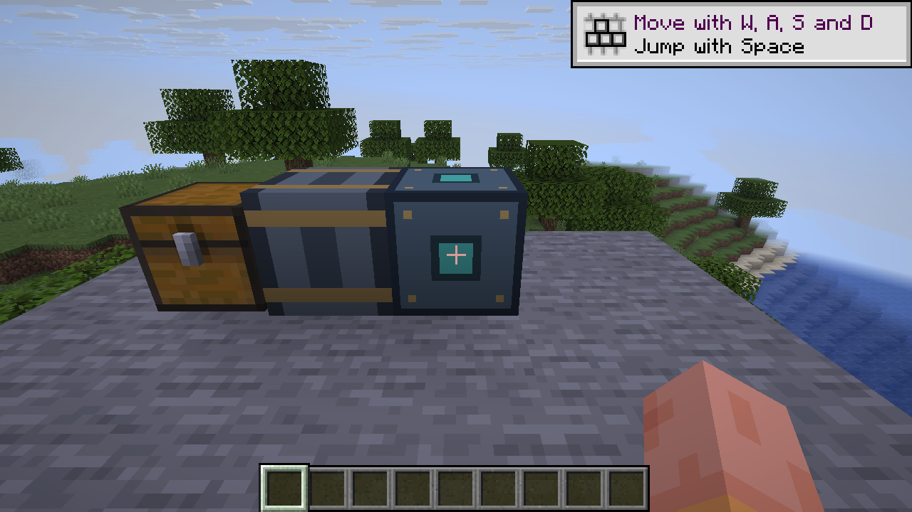
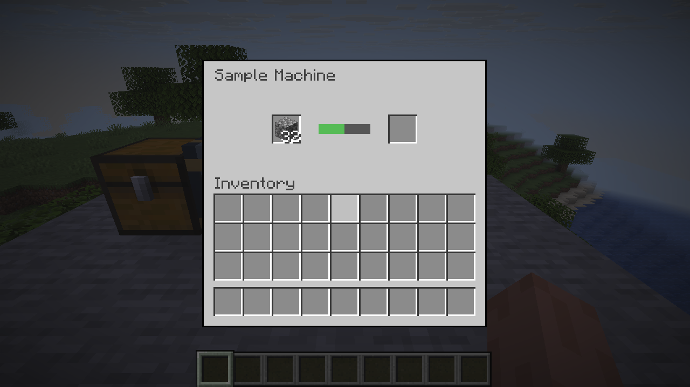

# Horizon machine sample

This native mod shows a small machine, its screen, a recipe, and a fixed pipe
transfer in Horizon. It also provides a way to test native hooks and helpers
from a mod through to a running game.



## What's in it

- A machine with a custom two-slot screen backed by a five-slot hopper menu.
  Only the input and output slots are shown. Its
  `machine_sample:processing` recipe is designed to finish in 40 ticks.
  Its Deposit button moves the carried stack into the input slot, up to the
  item stack limit. Incompatible items remain on the cursor.
- One pipe segment that moves output into a container. Place the pipe directly
  east of the machine and the container directly east of the pipe. The machine
  attempts to insert one item per tick into the container's west face. Other
  orientations and pipe networks are not supported.
- A native bundle and a separate `machine_sample` content mod. The bundle ID
  and module name are also `machine_sample`.



*Machine screen from an earlier build with a generic menu. The hopper-backed
layout has not yet been visually verified at the current pin.*

## Try it

The sample pins Horizon commit `1b6e55d4f3bd14079551bcad173d0fac8f8225bb`.
The exact Horizon and Mixins revisions are in [compatibility.json](compatibility.json).
The native bundle runs code with the player's rights. Only use native mods you
trust. Set `HORIZON_MIXINS` to a checkout at the pinned Mixins revision.

```sh
cargo test --workspace --locked --offline
python3 tools/horizon.py stage --horizon /path/to/horizon
python3 tools/horizon.py check --horizon /path/to/horizon --target-dir /path/to/cargo-target
python3 tools/horizon.py build --horizon /path/to/horizon --target-dir /path/to/cargo-target
```

The build prints the `horizon-client` path. Run it with your own prepared 26.3
resources and this repository's content folder:

```sh
/path/to/cargo-target/fast/horizon-client --resources /path/to/prepared/26.3 \
  --game-dir /path/to/a/fresh/game --dev-mod "$PWD/content" --world Sample --creative
```

The game needs a display. On a headless machine, use a virtual display such as
Xvfb. The game loads the content folder directly for this run. For a packaged
content mod and installation steps, see [content/README.md](content/README.md).

## Test a hook or helper end to end

Change the bundle under `mixins/machine_sample/` to call the hook or helper you
want to test. Run the standalone tests, stage and build the pinned client, then
launch it with the content folder as shown above. Exercise the behavior in a
fresh world and check the result on the intended game thread. This is the
recommended mod test route for hook work in
[Horizon #4953](https://github.com/horizon-rust/horizon/issues/4953).
The staging tools export committed Horizon sources; they do not change the
original checkout.

## Recipe status

The pinned revision includes [Horizon PR #5120](https://github.com/horizon-rust/horizon/pull/5120),
which fixes recipe lookup on the normal server thread. In an integrated-server
game test at the previous pin (`571ec1b76e186d0b5cd17c8f4eb35cb6894b5d35`),
four cobblestone became four stone in the east chest after 250 ticks. Both
machine slots were empty; no stone was added by hand. This test covers one
recipe and the east pipe, not a dedicated server. At the current pin, an
integrated-server game test also converted four cobblestone into four stone
in the east chest.

At an earlier pin, the screen opened but four cobblestone stayed idle. Four
manually loaded stone moved through the pipe into the east chest.

## Notes

The legacy `tools/test_template.py` fixture targets the original break-block
example; it does not validate this bundle. Use `tools/test_stage.py` against
the pinned Horizon source instead. See [CONTRIBUTING.md](CONTRIBUTING.md) and
`tools/` for validation and source audit details. The repository does not
include game assets.
