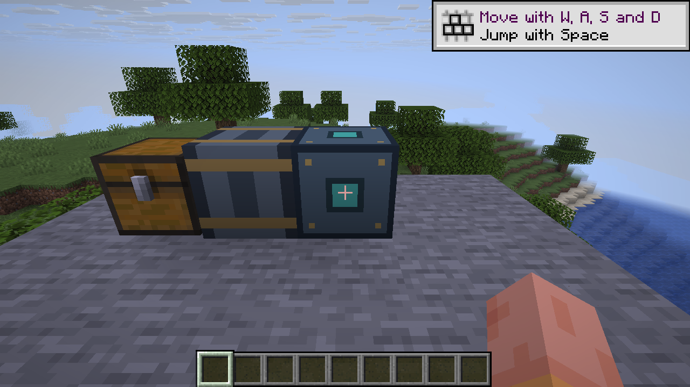

# Horizon machine sample

This native trait mod demonstrates a small machine, its screen, a recipe, and a
fixed pipe transfer in Horizon. It also provides an end-to-end test for the
native mod API.



The machine has a custom two-slot screen backed by a five-slot hopper menu.
The Deposit button moves the carried stack into input slot 0; compatible items
are processed in 40 ticks into output slot 1. It pulls one item from slot 0 of a
container directly west, through that container's east face. A pipe directly
east sends one output item per tick into a container east of the pipe, through
its west face. Other orientations and pipe networks are not supported. The
machine exposes both slots on every face; slot 0 accepts input and slot 1 allows
output.

## Build and test

The sample pins fork Horizon commit `c64f46ac4fe95b02d5a14bacf074b1991d187ae1`.
The exact Horizon and Mixins revisions are in [compatibility.json](compatibility.json).
Native mods run code with the player's rights; only build code you trust. The
launcher builds the sample from the source the mod pins and links its generated
entry into the game. With a scratch launcher instance and an installed base version:

```sh
horizon-launcher native-build "$PWD" --instance INSTANCE --trust-native-code --profile dev
```

Play the resulting build with this content mod enabled in a fresh world. See
[CONTENT.md](CONTENT.md) for packaging and [VALIDATION.md](VALIDATION.md) for
what has and has not been verified. For local source and trait-crate checks:

```sh
cargo fmt --all --check
cargo clippy --workspace --all-targets --locked --offline -- -D warnings
cargo test --workspace --locked --offline
python3 tools/test_stage.py --horizon /path/to/horizon
python3 tools/horizon.py check --horizon /path/to/horizon --target-dir "$PWD/target/horizon-cargo"
```

The stage test exports the pinned committed source, verifies shared dependency
versions against its lockfile, and stages the trait bundle; the check compiles
the trait crate, **not** a linked executable. Both leave the
original checkout unchanged. The launcher's native build is necessary to verify
linking and gameplay. `--offline` needs the dependencies in Cargo's cache.

## Package and API

Install `cargo-horizon-mod` from the matching Horizon fork build. The current
package contains `horizon-mod.toml`, `assets/`, `data/`,
`horizon-native.json`, and `native/`. Its `native/horizon-mixin.toml` declares
`[api] path = "rust"`; `native/rust/src/lib.rs` marks its `Hooks` implementation
with `#[mod_api::horizon_mod]`, which exports the entry and registers the
machine's `BlockEntityPart`. It uses `ITEMS` to reach neighboring inventories
and scoped screen and menu hooks for its UI. Raw mixin injections are a rare
escape hatch; this sample uses none.

Run `python3 tools/package.py` to create `target/horizon-mod/machine_sample.hmod`
with Horizon's shared writer. `python3 tools/test_package.py` checks packaging
and the native bundle's staging mapping. The engine pin is recorded in
`compatibility.json`, `horizon-native.json`, the native manifest and the crate
dependency and workspace dependency patches; update them together and seed
`Cargo.lock` from the pinned game's lockfile. No game assets are included.

To test a hook or helper end to end, change the trait mod, build the linked game
with the launcher and exercise the behavior on the intended game thread. This
is the recommended mod test route for hook work in
[Horizon #4953](https://github.com/horizon-rust/horizon/issues/4953).
