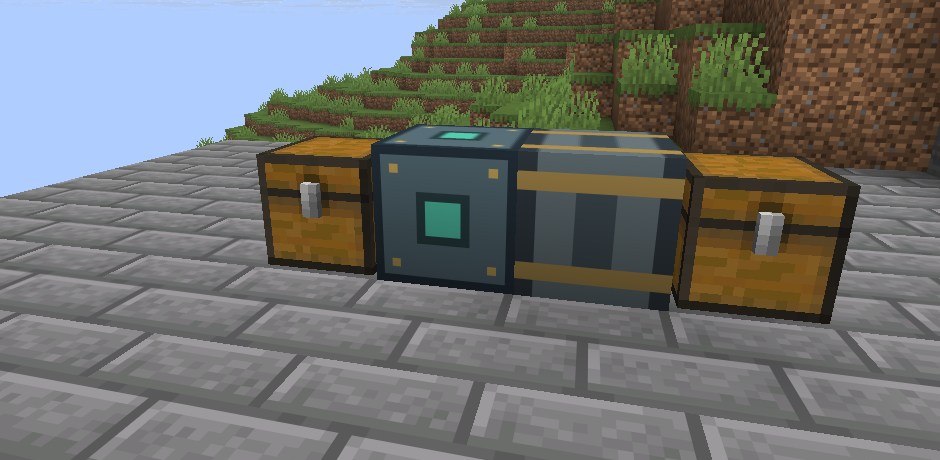
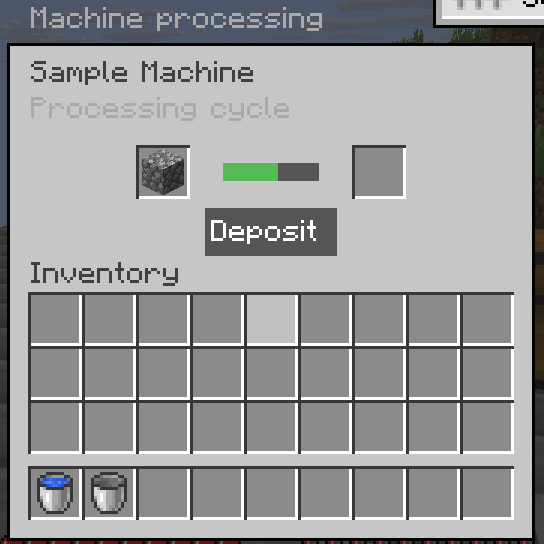
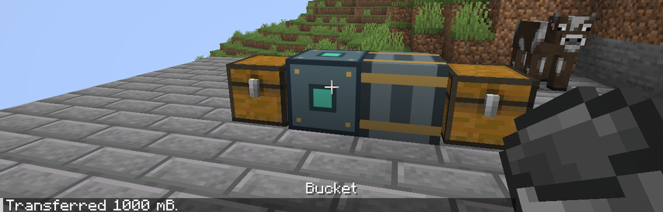
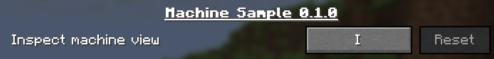
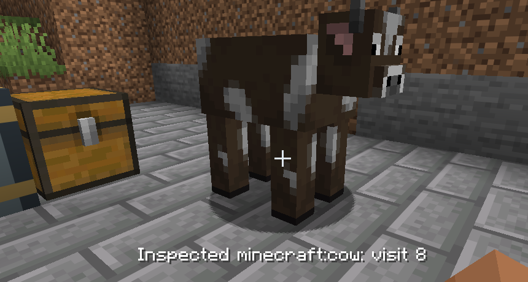
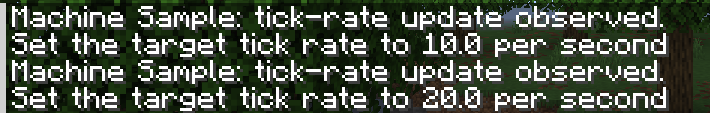

# Horizon machine sample

A small native Horizon mod with a working machine, a screen and a pipe. It also
serves as a tour of the mod API: each example is a small module you can read,
change and try in a fresh world.



## What's inside

| Example | What it demonstrates | In the game |
| --- | --- | --- |
| [Machine](src/machine.rs) | Pull an item from the west, process it, and send the result east through a pipe. |  |
| [Services](src/tour/services.rs) | An operator announcement command with typed sources and source-routed feedback. | Chat messages |
| [Fluid tank](src/tour/fluids.rs) | A saved 4,000 mB tank; fill and drain it using a held bucket and transactions. |  |
| [Energy](src/tour/energy.rs) | Recover 25 energy per recipe into a saved buffer exposed on every face. | Saved block-entity data |
| [Client](src/tour/client.rs) | A remappable inspection key, camera changes, local sound and a screen overlay. |  |
| [Reload](src/tour/reload.rs) | Read processing times from `data/` and a screen label from `assets/`, with pack overrides. | Label above the machine screen |
| [Tags and gamerules](src/tour/policy.rs) | A reloadable input tag and a gamerule that pauses automatic intake. | Recipe membership and intake policy |
| [Attachments](src/tour/attachments.rs) | Inspect an entity with an empty main hand to record a persistent visit count. |  |
| [Tick-rate hook](src/lib.rs) | Observe a server tick-rate update through the typed `server_tick_rate_changed` hook. |  |

The default recipe turns cobblestone into stone in 40 ticks. The machine has two
visible slots; its Deposit button accepts the carried stack. This is a fixed
west-to-east transfer example, not a pipe network.

[Try each example](VALIDATION.md#feature-tour-triggers) for the commands, gestures
and expected results. Hooks and Parts cover every example; no injections or source adapters are needed.
This sample has not been built as wasm.

## Build and run

No `sdk-<build id>` release exists for the pinned Horizon build yet, so the sample is
built the way a mod author builds against an unpublished commit: with the
launcher's developer SDK, from a checkout of [the pinned commit](horizon-mod.toml).
Native mods run with your rights: read the source before trusting it. The steps
below follow Horizon's
[local developer builds](https://github.com/arismoko/horizon/blob/main/docs/modding/src/how-to/native-mods/07-local-developer-builds.md)
page; `HORIZON` is a clean checkout of the pinned commit with its companion programs,
exporters and prepared resources made as that page lists, installed once with
`horizon-launcher developer-install` (it prints a `developer-…` tag, `DEVELOPER_TAG` below).

```sh
git clone https://github.com/arismoko/horizon-machine-sample.git
cd horizon-machine-sample
(cd HORIZON && python3 tools/prebuilt_game.py build SDK_FOLDER)
export HORIZON_LAUNCHER_DEVELOPER_SDK=SDK_FOLDER
horizon-launcher instance create "Machine Sample"
horizon-launcher instance version "Machine Sample" DEVELOPER_TAG
horizon-launcher native-build "$PWD" --instance "Machine Sample" --version DEVELOPER_TAG --trust-native-code
```

The last command ends with:

```text
Built (optimized, prebuilt)
native-c417323-<key> built and selected for its instance.
```

A second run with nothing changed prints `Up to date (no build needed)`. Measured for this
mod on one busy 8-CPU box (three runs each, Rust already downloaded, SDK already built):
unchanged 0.31–0.35 s, after editing `src/lib.rs` 2.0–2.8 s. A clean build and the SDK's
own build were not timed. The game was started and driven with the `horizon-ctl` that
`native-build` installs beside the executable, with `HORIZON_LAUNCHER_DEVELOPER_OFFLINE=1`
(the launcher's `play` was not run); [VALIDATION](VALIDATION.md#played-at-the-current-pin)
lists what was done and seen.

The project names the API by its SDK path, `.horizon/sdk/api/crates/horizon-mod-api`
(ignored by git). `cargo horizon-mod` fetches the signed SDK there for a published
build; for this unpublished one, the launcher's build does not need the folder, but an editor or
`cargo check` does: `python3 tools/sdk_api_source.py build .horizon/sdk/api` in `HORIZON` writes it. Once an
`sdk-<build id>` release exists for the pin, `cargo horizon-mod check` and `build` do this by themselves.

[Development and packaging](docs/DEVELOPMENT.md) covers exact revisions, the flat
package layout, source checks and common build prerequisites.

## How it's tested

- CI checks formatting, clippy and standalone unit tests. Horizon's daily run builds the sample at its pinned commit against that day's API source.
- The staging test checks the pinned source export, canonical package writer,
  deterministic output and that the original checkout stays unchanged.
- The sample declares no `[[inject]]`; the former injection-placement helper no longer builds
  against Horizon and was removed.
- The older pictures come from an actual linked Developer build on software Vulkan.
  Processing and pipe output, tank transfers, saved machine data, and an entity's
  inspection counter across save/reopen were exercised. They are not proof of
  every API path; keyboard camera/sound and pack overrides remain unverified.

[Validation](VALIDATION.md) separates automated checks from gameplay checks and
lists the triggers for every module. [Contributing](CONTRIBUTING.md) has the
commands to run before a code change.
